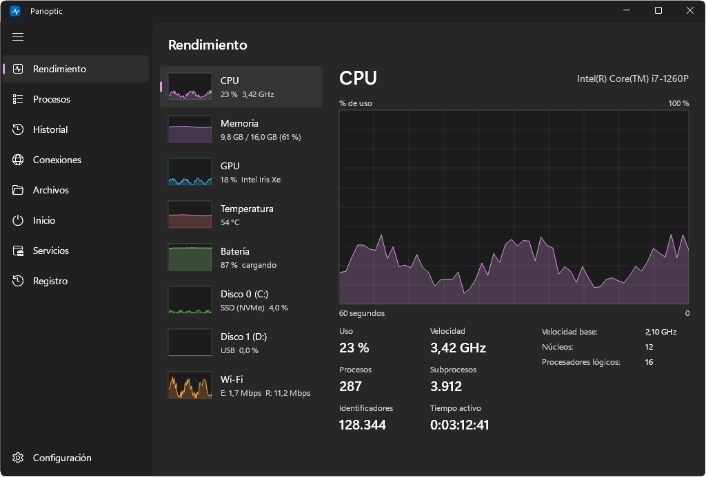
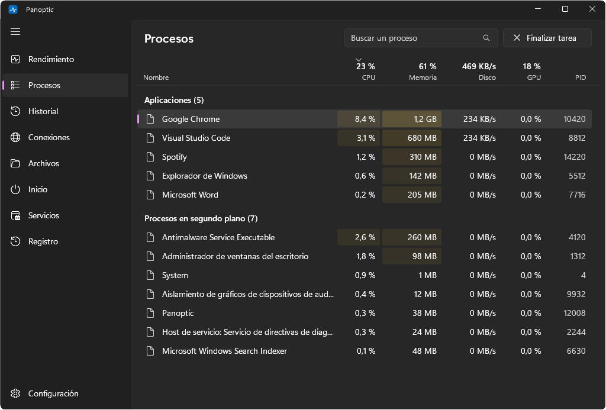
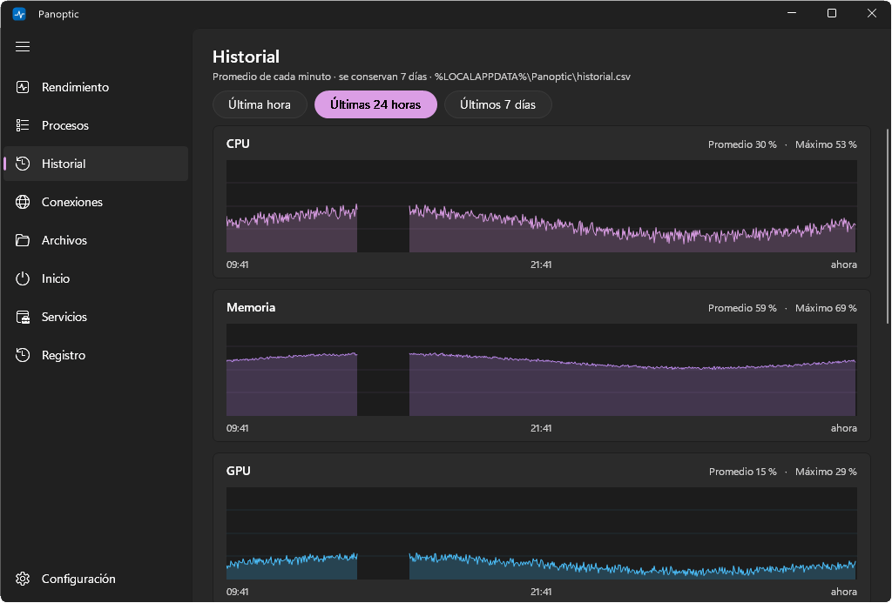
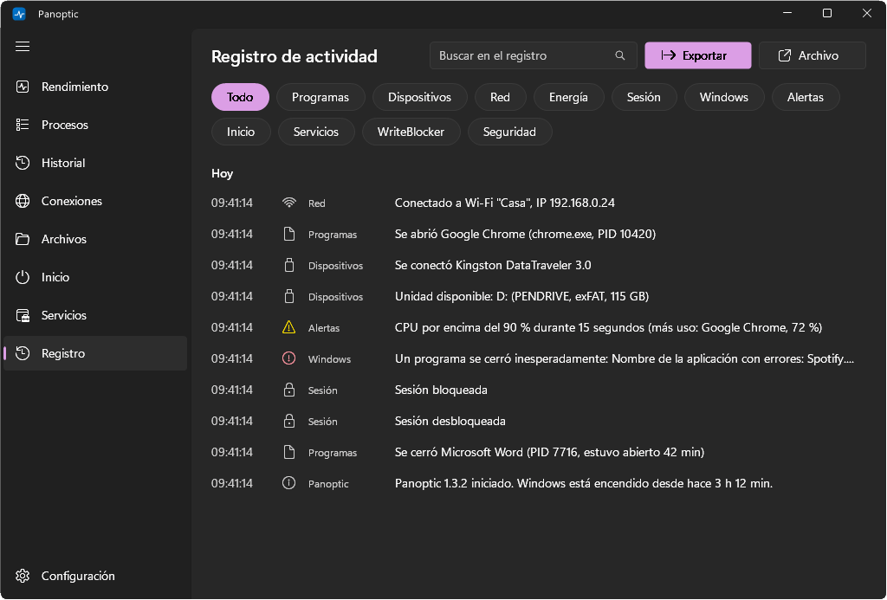
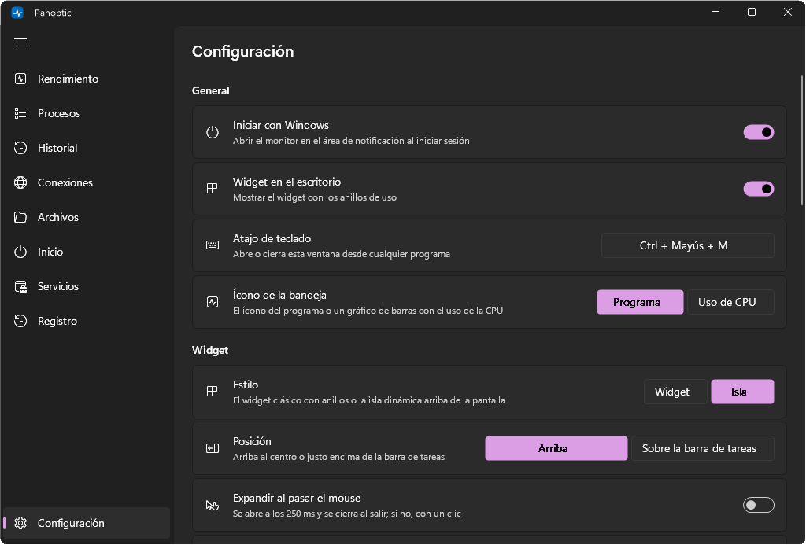
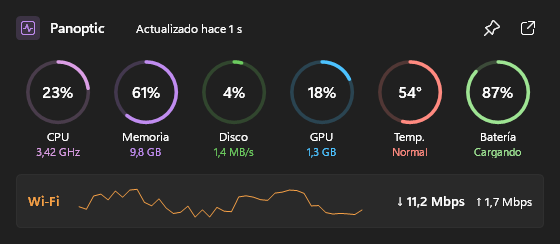
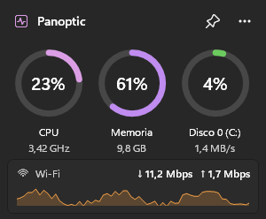
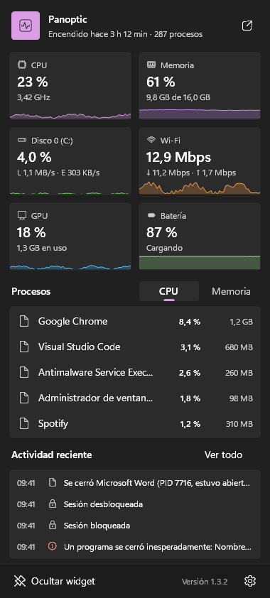

# Panoptic

**Versión 1.4.0** · Autor: **@villargonza**

Rendimiento en vivo, procesos y registro de actividad de la PC, con el estilo de Windows 11. Funciona sin permisos de administrador; las [funciones avanzadas](#funciones-de-administrador) los piden una sola vez.

> Antes se llamaba **Monitor del sistema**. Al abrir Panoptic por primera vez se pasan solos la configuración, el historial, el registro y el inicio con Windows; si las funciones de administrador estaban activas, se reactivan pidiendo permiso una vez.



| Procesos | Historial |
|---|---|
|  |  |
| **Registro de actividad** | **Configuración** |
|  |  |

| Isla dinámica | Widget | Panel de la bandeja |
|---|---|---|
| <br><br> |  |  |

*Capturas con datos de demostración.*

## Uso

- **Ícono de bandeja:** un mini gráfico con el uso de CPU de los últimos segundos. Al pasar el mouse muestra CPU, memoria y disco.
- **Clic izquierdo:** abre un panel con:
  - CPU, memoria, disco y red, con gráficos.
  - Los procesos que más consumen.
  - La actividad reciente.
- **Clic derecho:** abre el menú con Abrir, Widget, Iniciar con Windows, Administrador de tareas, Registro y Salir.

### Ventana principal

| Sección | Qué muestra |
|---|---|
| **Rendimiento** | Gráficos de 60 segundos de CPU, memoria, cada disco y cada red, con sus datos: velocidad, núcleos, memoria confirmada, tiempo de respuesta, IP, SSID, etc. |
| **Procesos** | Lista completa separada en Aplicaciones y Procesos en segundo plano. Se puede ordenar por columna (CPU, Memoria, Disco, PID) y buscar con `Ctrl+F`. Para finalizar una tarea: botón, `Supr` o clic derecho. |
| **Historial** | Promedio de cada minuto de CPU, memoria, GPU, disco, red, temperatura y batería, de la última hora, 24 horas o 7 días. Al pasar el mouse muestra la hora y el valor. |
| **Conexiones** | Conexiones TCP/UDP con el programa dueño, la dirección remota (con nombre de host) y el estado. Se puede filtrar por establecidas, en escucha y UDP. |
| **Archivos** | Qué archivos lee y escribe cada programa (requiere las funciones de administrador). |
| **Inicio** | Programas que arrancan con Windows (registro, carpetas de Inicio y tareas programadas), con su editor. Se pueden habilitar y deshabilitar. |
| **Servicios** | Servicios de Windows con su estado y tipo de inicio. Se pueden iniciar, detener y reiniciar (pide permisos si hace falta). |
| **Registro** | Todo lo que pasa en la PC, agrupado por día, con filtros y búsqueda. **Exportar** genera un HTML o CSV por rango de fechas. |
| **Configuración** | Inicio con Windows, widget, atajo de teclado, umbrales de alertas, avisos de seguridad e historial. |

Rendimiento también muestra **GPU** (uso por motor y por proceso), **temperatura** del equipo y **batería** (carga, tiempo restante, potencia y salud). Procesos tiene una columna de GPU.

**Atajo de teclado:** `Ctrl + Mayús + M` abre o cierra la ventana desde cualquier programa (se cambia en Configuración).

Cerrar la ventana no cierra el monitor, que sigue en la bandeja. Para cerrarlo del todo, usá **Salir**.

### Qué se registra

- **Programas:** cuándo se abren y se cierran. Se omiten los procesos internos de Windows que se abren todo el tiempo.
- **Dispositivos:** USB que se conectan y desconectan, unidades nuevas y cambios de pantalla.
- **Red:** conexión y desconexión, red Wi-Fi e IP.
- **Energía:** suspensión, reanudación, enchufe o batería, y batería baja.
- **Sesión:** bloqueo, desbloqueo y conexiones remotas.
- **Windows:** errores del Visor de eventos, como programas que se cierran inesperadamente o dejan de responder.
- **Alertas:** CPU, memoria, GPU, temperatura, batería baja y espacio en disco, con umbrales configurables y notificación de Windows.
- **Inicio y servicios:** programas de inicio y servicios nuevos o eliminados (también entre sesiones) y servicios instalados según el Visor de eventos (evento 7045).
- **Puertos en escucha:** cuando un programa empieza a aceptar conexiones. Se marca si es accesible desde la red.
- **WriteBlocker:** los eventos del bloqueo de escritura se suman a la misma línea de tiempo.

El registro se guarda en `%LOCALAPPDATA%\Panoptic\registro.log`.

### Funciones de administrador

Se activan en **Configuración > Funciones de administrador** (pide permiso una sola vez). Instalan una tarea programada, `PanopticHelper`, que inicia `Panoptic.exe --helper` con privilegios al iniciar sesión; la ventana sigue sin privilegios y se comunica con el ayudante por un canal que solo acepta al propio `Panoptic.exe` del mismo usuario. Desactivar el interruptor quita la tarea. Requiere Windows de 64 bits.

- **Procesos con línea de comandos:** cada programa que se ejecuta, con su comando completo y el proceso que lo lanzó. Se marcan como sospechosos los ejecutables usados en ataques (mshta, rundll32, certutil…), Office abriendo una consola y PowerShell codificado u oculto.
- **Seguridad de Windows:** inicios de sesión (y los fallidos, con aviso ante 5 o más en 5 minutos), cuentas creadas, eliminadas o bloqueadas, cambios en grupos de administradores, tareas programadas nuevas y borrado del registro de seguridad. Aparecen con el filtro **Seguridad** del Registro.
- **Tráfico por programa:** columna **Red** en Procesos y columnas Envío, Recepción y Total en Conexiones.
- **Archivos:** página nueva con los archivos que lee y escribe cada programa. Solo mide mientras está abierta.
- **Salud de los discos (SMART):** temperatura, salud, desgaste, horas de uso y errores en el detalle de cada disco, con alertas.
- **Firewall:** clic derecho en un proceso o conexión > **Bloquear su conexión a internet**. Los bloqueados se listan en Configuración para desbloquearlos.
- **Control de procesos:** finalizar procesos del sistema o de otros usuarios, y cambiar **prioridad** y **afinidad de procesadores** (clic derecho en un proceso).

### Transparencia

Si en Windows están activados los **Efectos de transparencia** (Configuración > Personalización > Colores), la ventana principal usa **Mica** y el panel y el widget usan **Acrílico**, como las apps de Windows 11. Si se desactivan, todo pasa a fondo sólido en el momento.

### Isla dinámica

Es el estilo predeterminado. En **Configuración > Widget > Estilo** se elige entre **Isla** y el **Widget** clásico, sin reiniciar.

- **Compacta:** barra arriba al centro con mini anillos de CPU, memoria y temperatura, más la bajada de red. La rueda del mouse cambia la vista entre CPU·Mem·Temp, CPU·GPU·Disco y Red.
- **Expandida** (clic, o al pasar el mouse si está activado): seis anillos con su detalle, la red con su gráfico y los botones Fijar y Abrir. Se expande con un rebote y se cierra con un clic afuera o con Esc.
- **Sobre la barra de tareas:** la otra posición. Usa barras en lugar de anillos y suma los 3 procesos que más consumen; con clic derecho sobre uno se puede finalizar.
- **Estados contextuales** (durante unos segundos): descarga activa, temperatura alta, un proceso que usa más del 40 % de CPU durante 2 minutos (con botón Finalizar tarea), cargador conectado y USB conectado. Se encolan, los críticos van primero y no se repiten en 5 minutos.
- No aparece en la barra de tareas ni en Alt+Tab, no roba el foco y se oculta con apps en pantalla completa.

### Widget

Muestra **anillos de progreso** para CPU, memoria y disco, con el porcentaje en el centro y una animación suave al cambiar. Debajo está la red, con la velocidad de bajada y subida y un gráfico.

Se activa desde el panel ("Mostrar widget") o desde el menú. Para usarlo:

- Se mueve arrastrándolo.
- El botón de la chincheta lo deja siempre visible, arriba de todo.
- Con clic derecho o el botón `···` se puede bloquear su posición u ocultarlo.

La posición y las opciones se guardan entre sesiones.

## Compilar

```bash
powershell -ExecutionPolicy Bypass -File build.ps1
```

Usa el compilador de C# que trae Windows (.NET Framework 4.8) y firma el ejecutable con el certificado de @villargonza.

Para revisar el diseño sin tocar el sistema, `Panoptic.exe --render carpeta [dark|light]` genera capturas con datos de ejemplo.
